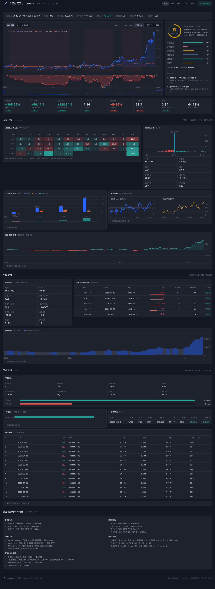
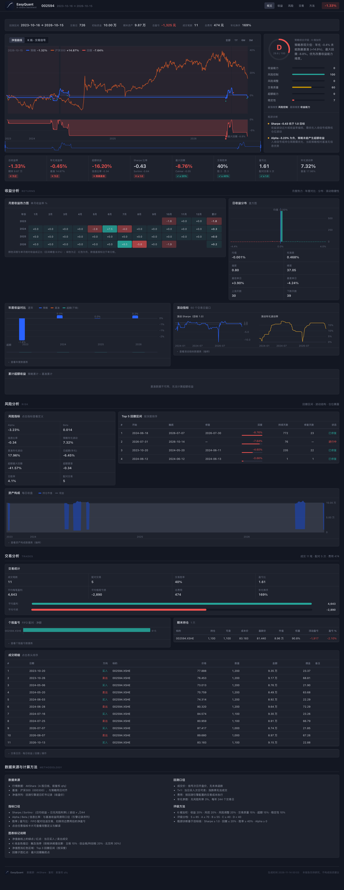
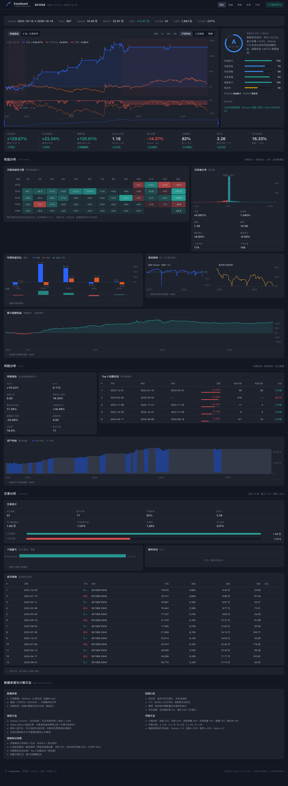
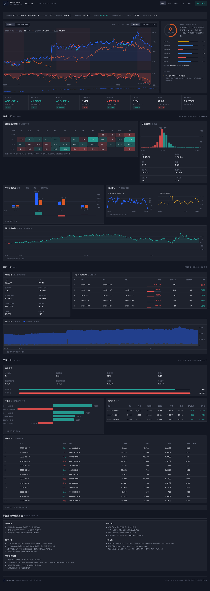
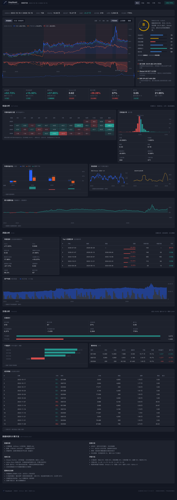

# Reading Backtest Reports

!!! abstract "Overview"

    | Item | Description |
    |------|-------------|
    | **Goal** | Understand PNG, HTML, Markdown, and JSON reports |
    | **Prerequisite** | [Running a Backtest](run-backtest.md) |

---
## 1. Backtest Report & Chart Guide

### 1.1 Charts (PNG)

Chart file: `reports/backtest_YYYYMMDD_HHMMSS.png`

The PNG is a dark-themed, four-panel dashboard:

- **Top-left: cumulative return (%)** — strategy vs. benchmark cumulative curves; green ▲ marks buys, red ▼ marks sells; the title bar shows P&L and trade count, and the lower-right corner annotates annualized return, Sharpe, and max drawdown
- **Top-right: six-dimension score bars** — scores (0–100) for return, risk, risk-adjusted, trade quality, excess, and stability, plus the overall grade
- **Middle: drawdown band** — portfolio drawdown (%) from its running peak
- **Bottom: last-12-month returns strip** — monthly returns, color-coded by sign

The PNG contains no per-stock candlesticks or moving averages — for K-line, MA, RSI, MACD and similar detail, use the HTML report (see §4.3).

### 1.2 Interactive HTML Report

File: `reports/backtest_YYYYMMDD_HHMMSS.html` — open with a browser. **Fully self-contained single file**: the chart engine is hand-rolled inline SVG with no CDN or network dependency, so it renders offline, behind corporate proxies, and after being emailed or archived.

Top to bottom (section navigation lives in the sticky toolbar):

1. **Header** — Brand, symbol, date range, total-return badge, section nav
2. **Overview** — Identity strip (period / trading days / capital / P&L / fees / turnover) → main chart stage (equity curve + linked drawdown pane + time-range slider, switchable to candlesticks with trade signals) → scorecard (grade ring + six-dimension meters + bottleneck diagnostics) → KPI band (8 cards with target pass/fail chips; click any card for the metric definition drawer)
3. **Returns** — Monthly returns heatmap, daily-return distribution (with stats), annual comparison, rolling Sharpe / volatility, cumulative excess return
4. **Risk** — Risk metric grid, Top-5 drawdown-period table, asset allocation (invested vs. cash)
5. **Trades** — Trade statistics (with avg win/loss comparison bars), per-stock P&L, end positions, sortable trade log, trade calendar
6. **Methodology** — Data sources, backtest conventions, metric formulas, grading method, chart-marker legend

**Full reading workflow:** Header & scorecard (did it make money? where's the bottleneck?) → KPI band (are Sharpe / drawdown on target?) → equity curve (position vs. the broad market, where trades landed) → drawdown table → trade log.

### 1.3 Markdown Report

File: `reports/backtest_YYYYMMDD_HHMMSS.md` — contains summary, trade records, and position information.

### 1.4 JSON Report

File: `reports/backtest_YYYYMMDD_HHMMSS.json` — machine-readable structured data.

```python
import json
with open('reports/backtest_20240101_120000.json') as f:
    report = json.load(f)
print("Total return: %.2f%%" % report['pnl_pct'])
```

---

## 2. Risk & Attribution Analysis

### 2.1 `analyze_returns`: Comprehensive Risk Metrics

```python
from eqlib import analyze_returns
metrics = analyze_returns(result, risk_free_rate=0.03)
```

| Metric | Description | Good Value |
|--------|-------------|------------|
| `total_return` | Total return rate | Positive, the higher the better |
| `annual_return` | Annualized return rate | Positive, the higher the better |
| `annual_volatility` | Annualized volatility | Lower is better |
| `sharpe_ratio` | Sharpe ratio | > 1 is good, > 2 is excellent |
| `sortino_ratio` | Sortino ratio | Only considers downside risk; > 1 is good |
| `max_drawdown` | Max drawdown | Closer to 0 is better |
| `calmar_ratio` | Calmar ratio | > 1 is good |
| `alpha` | Excess return (annualized) | Positive means outperforming benchmark |
| `beta` | Market sensitivity | 1 means moving in sync with the market |
| `information_ratio` | Information ratio | > 0.5 is good |
| `win_rate_daily` | Daily win rate | > 0.5 is good |
| `win_rate_trade` | Paired-trade win rate | Different meaning from daily win rate |

### 2.2 `brinson_attribution`: Attribution Analysis

```python
from eqlib import brinson_attribution
attr = brinson_attribution(result)
print("Allocation effect: %.4f" % attr['allocation_effect'])
print("Selection effect: %.4f" % attr['selection_effect'])
```

This is a single-period BHB decomposition that is mathematically closed: `allocation_effect + selection_effect + interaction_effect` always sums exactly to portfolio return minus benchmark return. The result also includes `portfolio_return`, `benchmark_return`, `benchmark_model` (how the benchmark was constructed), and a per-sector `sectors` breakdown.

### 2.3 `simple_factor_analysis`: Factor Analysis

```python
from eqlib import simple_factor_analysis
ff = simple_factor_analysis(result)
print("Market Beta: %.3f" % ff['market_beta'])
```

> **Note:** This function does **not** implement the true Fama-French three-factor model. The `momentum_correlation` field is return autocorrelation, not a true momentum factor exposure. `fama_french_analysis` is deprecated; use `simple_factor_analysis` instead.

See the [Report Format Specification](../reference/reports-format.md) for detailed metric field definitions.

---

## 3. What You Get After Running

In your code, call:

```python
from eqlib import run_strategy

result = run_strategy(
    initialize,
    start_date="2024-01-01",
    end_date="2024-12-31",
    starting_cash=100_000,
    benchmark="000300.XSHG",
    securities=["601390"],
    report_dir="reports",
)
```

The terminal will print file paths (timestamps vary each run):

| File | Purpose |
|------|---------|
| `reports/backtest_YYYYMMDD_HHMMSS.png` | Static chart: dark four-panel dashboard — strategy vs. benchmark cumulative return (with trade markers), six-dimension scores, drawdown, last-12-month returns |
| `reports/backtest_YYYYMMDD_HHMMSS.html` | **Interactive report**: metric cards, candlestick chart, cumulative returns, drawdown, daily P&L, trades and positions, etc. |
| `reports/backtest_YYYYMMDD_HHMMSS.md` | Human-readable summary + tabular trade records |
| `reports/backtest_YYYYMMDD_HHMMSS.json` | Structured data for programmatic analysis |

Open the `.html` file **directly in your browser** (double-click or File → Open) — no web server needed.

### 3.1 HTML Report Page Overview

After opening the `.html` file, the page is roughly divided into the following sections (screenshot below is from an Example 22 stock selection strategy backtest):



Header (symbol + period + total-return badge) → Overview (identity strip → main chart stage → scorecard → KPI band) → Returns (monthly heatmap / distribution / annual comparison / rolling metrics / cumulative excess) → Risk (risk metrics / drawdown periods / allocation) → Trades (statistics / per-stock P&L / positions / trade log / calendar) → Methodology.

---

## 4. HTML Report Page Structure (Top to Bottom)

Below is the logical order of sections generated by `generate_html_report`, to help you follow along on screen.

### 4.1 Header (Sticky Toolbar)

- **Left**: brand lockup, backtest symbol, date range.
- **Right**: section navigation (Overview / Returns / Risk / Trades / Methodology, highlighting the visible section as you scroll) and the **total-return badge** (green for gains, red for losses).

### 4.2 Overview: Identity Strip · Main Chart Stage · Scorecard · KPI Band

**Identity strip**: backtest period, trading days, initial capital, final value, total P&L, fill count, total fees, annualized turnover — the size and cost profile of the run at a glance.

**Main chart stage** (the visual center of the report, TradingView-style linked panes):

- **Equity curve** (default): strategy cumulative return (blue area line) vs. benchmark (orange line; switch between CSI 300 / SSE Composite / hidden in the top-right); **green / red dots** on the curve mark same-day buy / sell fills; **light red bands** mark the Top-3 drawdown periods; the **drawdown sub-pane** below shares the time axis and crosshair, with a red dot at the max-drawdown trough.
- **Candlesticks · trade signals**: OHLCV candles + volume + buy/sell triangle markers; candles touching the daily limit-up are outlined in **gold** (estimated from the board's limit threshold). The top-right switches symbols (multi-symbol backtests) and toggles **MA / BOLL / MACD / RSI** indicator panes.
- **Crosshair legend**: hovering shows the hovered day's values in the top-left (strategy / benchmark / drawdown on the equity view; OHLC, change, volume, MA values on candles).
- **Time-range slider**: a mini equity map with a draggable window, plus "All / 1Y / 6M / 3M" presets, zooming the main chart and every linked pane.

**Scorecard** (right of the chart): overall grade ring (S/A/B/C/D with a 0–100 score), six-dimension meters (return / risk control / risk-adjusted / trade quality / excess / stability), strongest/weakest tags, and **bottleneck diagnostics** — which metrics miss their targets, at what severity, and likely causes.

**KPI band**: total return, annualized return, excess return, Sharpe, max drawdown, trade win rate, profit/loss ratio, annualized volatility. Each card carries a **target chip** (✓/✗, e.g. Sharpe ≥ 1.0, drawdown ≤ 20%, win rate ≥ 40%). **Click any card** to open the metric definition drawer (formula, description, interpretation, and the current value's rating).

### 4.3 Returns

| Component | Content |
|-----------|---------|
| **Monthly returns heatmap** | Year × month grid, green positive / red negative with depth ∝ magnitude, values printed in cells, and the year's compounded total in the right column |
| **Daily-return distribution** | Histogram (adaptive bins, tails included) with a mean reference line; a side rail shows mean / std / skewness / kurtosis / best / worst day / up and down day counts |
| **Annual comparison** | Grouped bars of strategy vs. benchmark per year, with an excess strip below; values labeled at bar tips |
| **Rolling metrics** | Two linked small charts: 60-day rolling Sharpe (with the 1.0 target line) and rolling annualized volatility |
| **Cumulative excess** | Diverging area chart of strategy minus benchmark cumulative return (green above zero, red below) |

Every chart has a collapsible **table view** ("show data table") whose values match the chart exactly — for verification and accessible reading.

### 4.4 Risk

- **Risk metric grid**: Alpha, Beta, information ratio, strategy/benchmark annualized volatility, daily excess (annualized), excess max drawdown, excess Sharpe, daily win rate, paired-trade count — all clickable for definitions.
- **Top-5 drawdown periods**: sorted by depth, with start / trough / recovery dates, depth (with an inline depth bar), duration, recovery days, and status (recovered / ongoing).
- **Asset allocation**: stacked area of invested value vs. cash, with the day's position ratio on hover — cross-check the strategy's timing behavior.

### 4.5 Trades

- **Trade statistics**: fills, paired trades, win rate, profit/loss ratio, average win / loss (with comparison bars), total fees, annualized turnover.
- **Per-stock P&L**: diverging horizontal bars of FIFO round-trip net P&L (sorted by magnitude).
- **End positions**: symbol, amount, sellable (T+1), cost, last price, market value, weight, unrealized P&L.
- **Trade log**: every fill, **sortable by clicking the header**; non-fill events (order timeouts, delisting liquidation) appear muted.
- **Trade calendar** (collapsed by default): daily cumulative return / drawdown / operations.

### 4.6 Methodology

Data sources (AKShare, qfq-adjusted, benchmark aligned to the same trading days), backtest conventions (next-day open fills, T+1, no fills at price limits, fee breakdown), metric conventions (3% risk-free rate, 244 trading days per year), grading method, and the chart-marker legend.

### 4.8 Walkthrough Example

Below is a **historical example output** (target **601398**, period **2021-06-06 to 2024-06-06**, exported before the 2026-10 fix round) explaining **what each section means when you open the HTML**. After running `python examples/06_local_data.py`, open the **latest** `*.html` in `reports/` and read along with the table below.

> **Caveat on values:** the absolute numbers are a snapshot from that run. The current engine annualizes over 244 trading days, computes trade win rate on cost-inclusive FIFO round-trips, and `examples/06` now sets commission and slippage by default — rerunning produces different numbers. Focus on where each block lives and how to read it.

> **Note:** This example strategy is a simple MA 5/20 crossover strategy that **made a modest profit** in this period — positive Sharpe, controlled drawdown, and a decent win rate make it a good example for understanding what a "normal" strategy report looks like.

| Location in HTML | Approx. Value in This Example (see MD/JSON) | How to Read |
|-----------------|---------------------------------------------|-------------|
| **Header / Total P&L** | About **+16.11%** | Total return over the full period (relative to initial capital); matches `summary.pnl_pct` and `risk_metrics.total_return`. |
| **Summary row** | Initial 100,000 → Final **116,108** | Portfolio NAV after deducting trading costs. |
| **Annualized Return** | **+5.15%** | Annualized level derived from daily returns; slightly above the risk-free rate (~3%) but not spectacular. |
| **Annualized Volatility** | **12.83%** | Magnitude of return fluctuations; moderate, the curve is not too "jagged." |
| **Sharpe Ratio** | **+0.22** | Risk-adjusted return; slightly above 0, indicating modest excess return after accounting for risk. |
| **Sortino Ratio** | **+0.31** | Downside-risk-only adjusted metric; also positive when Sharpe is positive. |
| **Max Drawdown** | **-14.45%** | Largest peak-to-trough decline; moderate drawdown in this example means manageable risk-control pressure. |
| **Calmar Ratio** | **+0.36** | Annualized return / \|max drawdown\|; positive when returns are positive and drawdown is controlled. |
| **Daily Win Rate** | **29.4%** | `win_rate_daily`: proportion of profitable trading days; this strategy holds positions for longer periods, so daily win rate is low but per-trade gains are substantial. |
| **Win Rate (Trade)** | **65.3%** | `win_rate_trade`: proportion of profitable round-trips among completed buy–sell pairs; over half of the trades were profitable. |
| **Profitable / Losing Trades** | ~**125 / 66** | Win/loss counts at the paired-trade level; more winning trades than losing ones. |
| **Profit/Loss Ratio** | **0.97** | Average winner vs. average loser; close to 1 means winning and losing trades are roughly similar in magnitude. |
| **Trade Count (Paired)** | ~**95** | Number of completed "buy + sell" round-trips; differs from JSON `summary.num_trades` (one-sided trade count, 191 in this example) — see [FAQ](../project/faq.md#faq-json-num-trades). |
| **Annualized Turnover** | Low | This is a low-frequency timing strategy with relatively low turnover. |
| **Total Commission** | **0.00** (historical snapshot) | That run had no OrderCost configured; `examples/06_local_data.py` now sets commission and slippage by default, so new reports show the actual charged amount. |
| **Alpha / Beta / Information Ratio** | Depends on benchmark data | When the benchmark series is missing or overlaps the strategy by fewer than 10 trading days, all three come back as NaN: rendered as **N/A** in reports and `null` in JSON. See [FAQ](../project/faq.md#faq-benchmark-null). |

**Interactive area (equity curve, candlesticks, drawdown, distribution)**: hover for crosshair readings, drag the bottom slider or use the "All / 1Y / 6M / 3M" presets to zoom; compare the strategy line vs. the benchmark line for "did it beat the index?" The report is a fully offline single file (hand-rolled SVG, no CDN) and renders anywhere a browser can open it; if the chart areas are empty, check that JavaScript is enabled (see [FAQ — HTML Charts Blank](../project/faq.md#faq-html-blank)).

**Taking your own full-page HTML screenshot (optional)**: Go fullscreen in the browser and use the system screenshot tool (e.g., macOS `Cmd + Shift + 4`, Windows `Win + Shift + S`) to capture the header + metric cards area for notes or sharing conclusions with colleagues.

---

## 5. How to Read the PNG Chart (`generate_chart`)

Read it panel by panel:

- **Top-left cumulative return**: the strategy curve's position and slope versus the benchmark; cross-check the ▲/▼ trade markers against your strategy logic for "chasing highs, panic selling"; annualized return, Sharpe, and max drawdown sit in the lower-right corner.
- **Top-right score bars**: weak dimensions stand out immediately; when one dimension scores near 0, investigate that metric rather than the overall grade.
- **Middle drawdown band**: depth and duration of drawdowns; a wide red stretch with no new highs marks the strategy's main risk regime.
- **Bottom monthly strip**: the last 12 months of returns; runs of same-colored months signal a trending or ranging market.

If the chart is missing the cumulative-return curve, check whether `record` / recorded data is complete per [FAQ — PNG Is Sparse](../project/faq.md).

---

## 6. Comparing Reports Across Strategies: How to Judge Strategy Quality from Reports

Below are screenshots from 4 different strategies — same report structure, different numbers. Actual results will vary significantly depending on the backtest period, stock selection, and market conditions. These screenshots are for illustration only and do not imply the strategy will perform similarly in all market environments.






| Strategy | Type | Suitable Market | Key Metrics | Main Weakness |
|----------|------|-----------------|-------------|---------------|
| MACD trend + volume confirmation | Trend-following | One-way trends | Sharpe, cumulative-return slope | Repeated stop-outs in ranging markets |
| Bollinger mean reversion | Mean reversion | Range-bound | Win rate, profit/loss ratio | Consecutive losses in trending markets |
| Multi-factor selection | Portfolio rotation | Stable style regimes | Turnover, commission share of returns | High turnover erodes returns |
| Momentum portfolio | Momentum | Persistent trends | Sharpe, max drawdown, daily win rate | Large drawdowns on reversals and chop |

### How to Judge Strategy Quality from Reports

| Check | Good Strategy | Poor Strategy | Notes |
|-------|---------------|---------------|-------|
| **Annualized Return** | Positive, > 10% | Negative or < 5% | Basic requirement |
| **Sharpe Ratio** | > 1 | < 0 | Risk-adjusted return |
| **Max Drawdown** | < 15% | > 30% | Maximum loss tolerance |
| **Trade Win Rate** | > 50% | < 30% | Paired-trade win rate |
| **Profit/Loss Ratio** | > 1.5 | < 1 | Average winner / average loser |
| **Trade Frequency** | Moderate | Too many or too few | Too many = high costs |
| **Alpha** | Positive | Zero or negative | Source of excess return |

---

## 7. Advanced: Generating Only One Report Type

```python
from eqlib import run_backtest, generate_html_report, analyze_returns

result = run_backtest(initialize, "2024-01-01", "2024-12-31", securities=["601390"])
if result:
    generate_html_report(result, "reports/my_report.html")
    print(analyze_returns(result))
```

See the [API Reference — Report & Analysis APIs](../reference/api-analysis.md).
