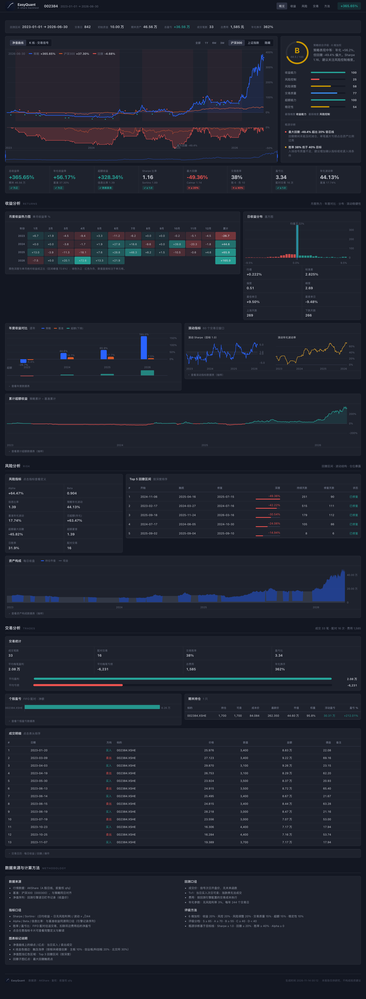
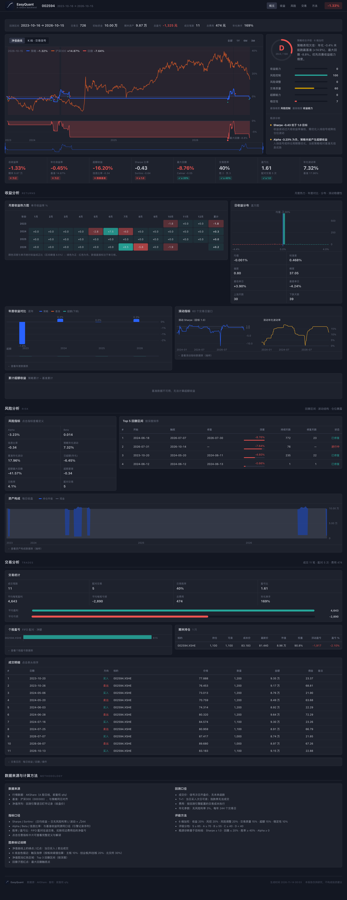
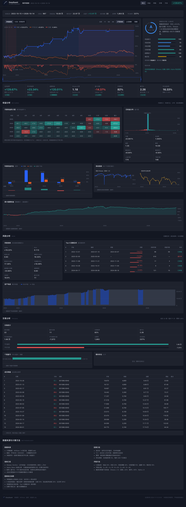
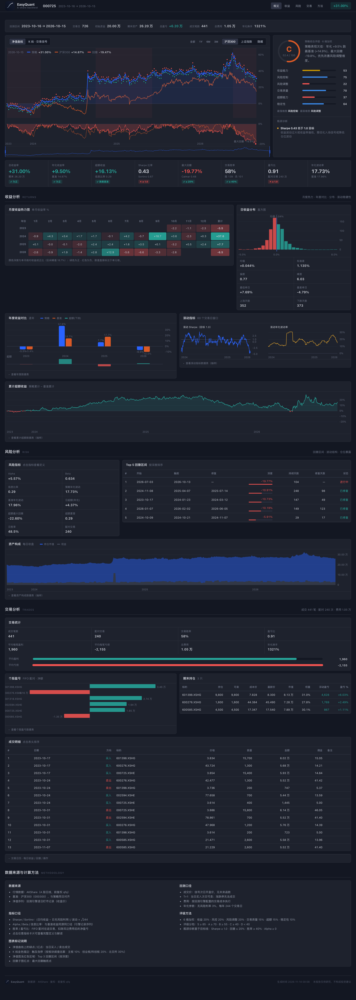
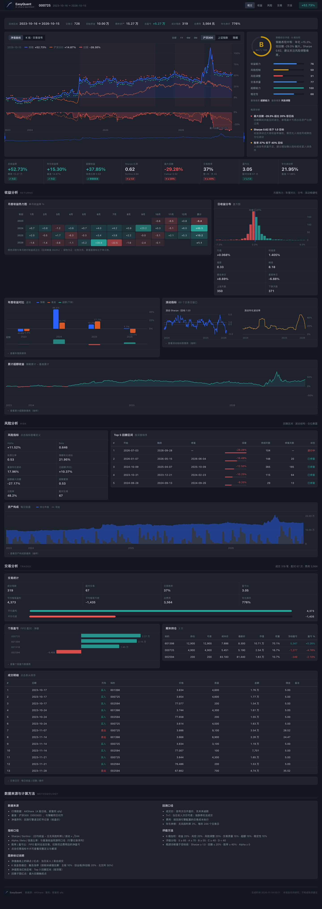

# 解读回测报告

!!! abstract "本篇导览"

    | 项目 | 说明 |
    |------|------|
    | **目标** | 理解 PNG、HTML、Markdown、JSON 四种报告 |
    | **前置** | [运行回测](run-backtest.md) |

---
## 1. 回测报告与图表解读

### 1.1 图表（PNG）

图表文件：`reports/backtest_YYYYMMDD_HHMMSS.png`

PNG 为深色主题的四区仪表盘：

- **左上：累计收益（%）** — 策略 vs 基准两条累计收益曲线；绿色 ▲ 为买入、红色 ▼ 为卖出；标题栏给出盈亏金额与成交笔数，右下角标注年化收益、夏普、最大回撤
- **右上：六维评分条** — 收益/风险/风险调整/交易质量/超额/稳定性六个维度的得分（0–100）与总评级
- **中部：回撤带** — 组合净值相对历史峰值的回撤（%）
- **底部：近 12 个月收益条** — 按月着色，红涨绿跌

PNG 不含个股 K 线与均线——需要 K 线、MA、RSI、MACD 等细节时看 HTML 报告（见 §4.3）。

### 1.2 交互式 HTML 报告

文件：`reports/backtest_YYYYMMDD_HHMMSS.html`，用浏览器打开。**完全自包含单文件**——图表引擎为内联手写 SVG，无任何 CDN / 外网依赖，离线、内网、邮件转发后均可正常打开。

页面自上而下分为（章节导航在吸顶工具栏右侧）：

1. **页头** — 品牌、标的、区间、总收益徽章、章节导航
2. **概览** — 身份条（区间/交易日/资金/盈亏/费用/换手）→ 主图区（净值曲线 + 回撤联动子图 + 时间范围滑块，可切换 K 线·交易信号）→ 评分卡（评级环 + 六维量表 + 瓶颈诊断）→ KPI 指标带（8 张卡，带目标线通过标记，点击查看指标定义）
3. **收益分析** — 月度收益热力图、日收益分布（含统计）、年度收益对比、滚动 Sharpe / 波动率、累计超额收益
4. **风险分析** — 风险指标网格、Top 5 回撤区间表、资产构成（持仓 vs 现金）
5. **交易分析** — 交易统计（含平均盈亏对比条）、个股盈亏、期末持仓、可排序成交明细、交易日历
6. **方法** — 数据来源、回测口径、指标口径、评级方法、图表标记说明

**完整阅读流程：** 页头与评分卡（赚钱了吗、瓶颈在哪）→ KPI 带（夏普/回撤达标吗）→ 净值曲线（相对大盘位置、买卖点落位）→ 回撤区间表 → 成交明细。

### 1.3 Markdown 报告

文件：`reports/backtest_YYYYMMDD_HHMMSS.md`，包含摘要、交易记录、持仓信息。

### 1.4 JSON 报告

文件：`reports/backtest_YYYYMMDD_HHMMSS.json`，机器可读的结构化数据。

```python
import json
with open('reports/backtest_20240101_120000.json') as f:
    report = json.load(f)
print("总收益: %.2f%%" % report['pnl_pct'])
```

---

## 2. 风险与归因分析

### 2.1 `analyze_returns`：综合风险指标

```python
from eqlib import analyze_returns
metrics = analyze_returns(result, risk_free_rate=0.03)
```

| 指标 | 说明 | 好值 |
|------|------|------|
| `total_return` | 总收益率 | 正数越大越好 |
| `annual_return` | 年化收益率 | 正数越大越好 |
| `annual_volatility` | 年化波动率 | 低一些更好 |
| `sharpe_ratio` | 夏普比率 | > 1 为好，> 2 为优秀 |
| `sortino_ratio` | 索提诺比率 | 只考虑下行风险，> 1 为好 |
| `max_drawdown` | 最大回撤 | 接近 0 越好 |
| `calmar_ratio` | 卡玛比率 | > 1 为好 |
| `alpha` | 超额收益（年化） | 正数为跑赢基准 |
| `beta` | 市场敏感度 | 1 表示与大盘同步 |
| `information_ratio` | 信息比率 | > 0.5 为好 |
| `win_rate_daily` | 日胜率 | > 0.5 为好 |
| `win_rate_trade` | 配对交易胜率 | 与日胜率含义不同 |

### 2.2 `brinson_attribution`：归因分析

```python
from eqlib import brinson_attribution
attr = brinson_attribution(result)
print("配置效应: %.4f" % attr['allocation_effect'])
print("选股效应: %.4f" % attr['selection_effect'])
```

这是单期 BHB 分解，数学上严格闭合：`allocation_effect + selection_effect + interaction_effect` 恒等于组合收益减基准收益。返回值还包含 `portfolio_return`、`benchmark_return`、`benchmark_model`（基准构造方式）和分行业的 `sectors` 明细。

### 2.3 `simple_factor_analysis`：因子分析

```python
from eqlib import simple_factor_analysis
ff = simple_factor_analysis(result)
print("市场 Beta: %.3f" % ff['market_beta'])
```

> **注意：** 本函数**不实现**真正的 Fama-French 三因子模型。`momentum_correlation` 字段为收益自相关，非真正的动量因子暴露。`fama_french_analysis` 已弃用，请改用 `simple_factor_analysis`。

详细指标字段定义见 [报告格式规范](../reference/reports-format.md)。

---

## 3. 运行后你会得到什么

在代码中调用：

```python
from eqlib import run_strategy

result = run_strategy(
    initialize,
    start_date="2024-01-01",
    end_date="2024-12-31",
    starting_cash=100_000,
    benchmark="000300.XSHG",
    securities=["601390"],
    report_dir="reports",
)
```

终端会打印类似路径（时间戳每次不同）：

| 文件 | 用途 |
|------|------|
| `reports/backtest_YYYYMMDD_HHMMSS.png` | 静态图：深色四面板——策略 vs 基准累计收益（含买卖点）、六维评分、回撤、近 12 月收益 |
| `reports/backtest_YYYYMMDD_HHMMSS.html` | **交互式报告**：指标卡片、K 线、累计收益、回撤、每日盈亏、成交与持仓等 |
| `reports/backtest_YYYYMMDD_HHMMSS.md` | 人类可读的摘要 + 表格化交易记录 |
| `reports/backtest_YYYYMMDD_HHMMSS.json` | 程序化分析用结构化数据 |

用浏览器 **直接打开 `.html` 文件**（双击或「文件 → 打开」），无需启动 Web 服务器。

### 3.1 HTML 报告页面概览

打开 `.html` 文件后，你看到的页面大致分为以下区块（下图为单标的均线策略（002384，本地数据）的一次真实回测截图）：



页头（标的 + 区间 + 总收益徽章）→ 概览（身份条 → 主图区 → 评分卡 → KPI 指标带）→ 收益分析（月度热力 / 分布 / 年度对比 / 滚动指标 / 累计超额）→ 风险分析（风险指标 / 回撤区间 / 资产构成）→ 交易分析（统计 / 个股盈亏 / 持仓 / 成交明细 / 交易日历）→ 方法说明。

---

## 4. HTML 报告页面结构（从上到下）

以下为 `generate_html_report` 生成页面的逻辑顺序，便于你对照屏幕阅读。

### 4.1 页头（吸顶工具栏）

- **左侧**：品牌标识、回测标的、回测区间。
- **右侧**：章节导航（概览 / 收益 / 风险 / 交易 / 方法，随滚动高亮当前章节）与**总收益率徽章**（绿涨红跌）。

### 4.2 概览：身份条 · 主图区 · 评分卡 · KPI 指标带

**身份条**：回测区间、交易日数、初始资金、期末资产、总盈亏、成交笔数、总费用、年化换手——一眼确认回测的规模与成本。

**主图区**（报告的视觉中心，TradingView 风格多窗格联动）：

- **净值曲线**（默认）：策略累计收益（蓝色面积线）vs 基准（橙色线，右上角可切换 沪深300 / 上证指数 / 隐藏）；曲线上的**绿点 / 红点**为当日买入 / 卖出成交落位；**浅红色区域**标注 Top 3 回撤区间；下方**回撤子图**与主图共享时间轴与十字光标，红点标注最大回撤触底位置。
- **K 线 · 交易信号**：OHLCV 蜡烛图 + 成交量 + 买卖点三角标记；触及涨停的 K 线以**金色描边**标出（按板块阈值估算）。右上角可切换标的（多标的回测时）与开关 **MA / BOLL / MACD / RSI** 指标子图。
- **十字光标图例**：鼠标悬停时左上角实时显示该交易日的数值（净值图为策略/基准/回撤，K 线图为开高低收/涨跌幅/量/均线值）。
- **时间范围滑块**：底部迷你净值图 + 可拖拽窗口，配合「全部 / 1Y / 6M / 3M」预设按钮缩放主图与所有联动子图。

**评分卡**（主图右侧）：综合评级环（S/A/B/C/D + 百分制得分）、六维量表（收益能力 / 风险控制 / 风险调整 / 交易质量 / 超额能力 / 稳定性）、最强/最弱维度标签，以及**瓶颈诊断**——未达标的指标、严重级别与可能成因。

**KPI 指标带**：总收益率、年化收益率、超额收益、Sharpe、最大回撤、交易胜率、盈亏比、年化波动率共 8 张卡片。每张卡附**目标线通过标记**（✓/✗，如 Sharpe ≥ 1.0、回撤 ≤ 20%、胜率 ≥ 40%），**点击卡片**打开指标定义抽屉（公式、说明、解读、当前值评级）。

### 4.3 收益分析

| 组件 | 内容 |
|------|------|
| **月度收益热力图** | 年 × 月网格，绿正红负、颜色深度 ∝ 绝对收益，数值直接标注于单元格，右侧为当年累计 |
| **日收益分布** | 直方图（自适应分箱，含尾部极端值），叠加均值参考线；侧栏给出均值 / 标准差 / 偏度 / 峰度 / 最佳 / 最差单日 / 涨跌天数 |
| **年度收益对比** | 策略 vs 基准分组柱状图，下方为超额收益条；柱顶标注数值 |
| **滚动指标** | 60 日滚动 Sharpe（含 1.0 目标线）与滚动年化波动率双联小图 |
| **累计超额收益** | 策略累计 − 基准累计的零轴分叉面积图（零上绿、零下红） |

每张图表下方都有可折叠的**数据表视图**（「查看数据表」），与图表数值完全一致，便于核对与无障碍阅读。

### 4.4 风险分析

- **风险指标网格**：Alpha、Beta、信息比率、策略/基准年化波动、日超额（年化）、超额最大回撤、超额夏普、日胜率、配对交易数——均可点击查看定义。
- **Top 5 回撤区间表**：按深度排序，含开始 / 触底 / 修复日期、深度（内嵌深度条）、持续天数、修复天数与状态（已修复 / 进行中）。
- **资产构成**：持仓市值与现金的堆叠面积图，悬停显示当日仓位占比——用于核对策略的仓位择时行为。

### 4.5 交易分析

- **交易统计**：成交笔数、配对交易、胜率、盈亏比、平均每笔盈利 / 亏损（含对比条）、总费用、年化换手。
- **个股盈亏**：FIFO 配对净盈亏的水平发散条形图（按绝对值排序）。
- **期末持仓**：标的、持仓、可卖（T+1）、成本价、最新价、市值、权重、浮动盈亏。
- **成交明细**：全量买卖记录，**点击表头排序**；超时撤单、退市清算等事件以弱化样式单独列示。
- **交易日历**（默认折叠）：每日累计收益 / 回撤 / 当日操作。

### 4.6 方法说明

数据来源（AKShare、前复权、基准同口径对齐）、回测口径（次日开盘价成交、T+1、涨跌停不可成交、费用明细）、指标口径（无风险利率 3%、244 个交易日年化）、评级方法与图表标记说明。

### 4.8 对照走读示例

下面用一次**历史示例输出**（标的 **601398**，区间 **2021-06-06～2024-06-06**，导出于 2026-10 修复轮之前）说明：**打开 HTML 时，各块数字在说什么**。运行 `python examples/06_local_data.py` 后，在 `reports/` 下打开**最新** `*.html`，对照下表阅读。

> **口径提示：** 表中绝对数值是那次运行的快照。当前引擎已统一 244 个交易日年化、胜率改为含双边费用的 FIFO 配对口径、`examples/06` 默认设置了佣金与滑点，重跑得到的数字会不同——关注每一块的位置与读法即可。

> **说明：**本示例策略为 MA 5/20 金叉死叉策略，在该区间**小幅盈利**，夏普为正、回撤可控，适合用来理解「正常策略的报告长什么样」。

| HTML 上常见位置 | 本例约值（见 MD/JSON） | 读法 |
|----------------|----------------------|------|
| **页眉 / 总盈亏** | 约 **+16.11%** | 全区间总收益率（相对初始资金），与 `summary.pnl_pct`、`risk_metrics.total_return` 一致。 |
| **摘要行** | 初始 100,000 → 期末 **116,108** | 已扣交易成本后的组合净值终值。 |
| **年化收益** | **+5.15%** | 由日收益折算的年化水平；高于无风险利率（约 3%）但不算高。 |
| **年化波动率** | **12.83%** | 收益波动幅度；适中，曲线不会太「抖」。 |
| **夏普比率** | **+0.22** | 风险调整后收益；略高于 0，说明承担了一定风险后略有超额收益。 |
| **索提诺比率** | **+0.31** | 只看下行波动的风险调整指标；夏普为正时通常也为正。 |
| **最大回撤** | **-14.45%** | 从峰值到谷底的最大跌幅；本例回撤适中，风控压力不大。 |
| **卡玛比率** | **+0.36** | 年化收益 / \|最大回撤\|；收益正、回撤可控时为正。 |
| **日胜率** | **29.4%** | `win_rate_daily`：盈利交易日占比；本策略持仓周期长，日胜率不高但单次盈利可观。 |
| **胜率（交易）** | **65.3%** | `win_rate_trade`：完整买—卖配对中，盈利回合占比；超过半数交易盈利。 |
| **盈利笔数 / 亏损笔数** | 约 **125 / 66** | 配对层面的赢/输笔数；盈利笔数明显多于亏损。 |
| **盈亏比** | **0.97** | 平均盈利单 / 平均亏损单；接近 1，说明盈利单笔和亏损单笔金额相近。 |
| **交易次数（配对）** | **约 95** | 完成「一轮买+卖」的组数；与 JSON `summary.num_trades`（单边成交条数，本例 191）不同，见 [FAQ](../project/faq.md#faq-json-num-trades)。 |
| **年化换手率** | 较低 | 本策略为低频择时策略，换手率不高。 |
| **总佣金** | **0.00**（历史快照） | 该次运行未配置 OrderCost；当前 `examples/06_local_data.py` 已默认设置佣金与滑点，新报告的佣金为实际收取值。 |
| **Alpha / Beta / 信息比率** | 取决于基准数据 | 基准序列缺失或与策略重叠不足 10 个交易日时，三项返回 NaN：报告中渲染为 **N/A**，JSON 中对应字段为 `null`。见 [FAQ](../project/faq.md#faq-benchmark-null)。 |

**交互区（净值曲线、K 线、回撤、分布等）**：鼠标悬停查看十字光标读数，拖动底部滑块或点击「全部 / 1Y / 6M / 3M」缩放；策略线 vs 基准线对比「是否跑赢指数」。报告为全离线单文件（手写 SVG，无 CDN），任何能开网页的环境都能完整渲染；若图表区域为空，请确认浏览器启用了 JavaScript（见 [FAQ — HTML 图表空白](../project/faq.md#faq-html-blank)）。

**自己截 HTML 长图（可选）**：浏览器全屏后使用系统截图（如 macOS `Cmd + Shift + 4`、Windows `Win + Shift + S`），截取页眉 + 指标卡片区，便于写笔记或与同事对齐结论。

---

## 5. PNG 图（`generate_chart`）怎么读

按四个区域读：

- **左上累计收益**：策略曲线相对基准的位置与斜率；▲/▼ 买卖点与策略逻辑对照，看是否存在「追高杀跌」；右下角直接给出年化收益、夏普、最大回撤。
- **右上评分条**：六个维度的短板一眼可见；某个维度接近 0 时，先查对应指标而非总评级。
- **中部回撤带**：回撤的深度与持续时间；长时间不创新高的宽红色区域是策略的主要风险段。
- **底部月度收益**：近 12 个月逐月收益；连续同色月份提示趋势市或震荡市。

若图中缺少累计收益曲线，请对照 [FAQ — PNG 很空](../project/faq.md) 检查 `record` / 记录数据是否完整。

---

## 6. 不同策略报告对比：如何通过报告判断策略好坏

以下是 4 个不同策略的回测截图，报告结构相同，数值各异。具体收益会因回测区间、标的选择和市场环境而大幅变化——截图仅供展示报告样式，不代表该策略在所有市场条件下都能取得类似表现。






| 策略 | 类型 | 适用行情 | 重点指标 | 主要短板 |
|------|------|---------|---------|---------|
| MACD 趋势 + 成交量确认 | 趋势跟随 | 单边趋势 | 夏普、累计收益斜率 | 震荡市反复止损 |
| 布林带均值回归 | 均值回归 | 区间震荡 | 胜率、盈亏比 | 趋势行情连续亏损 |
| 多因子选股 | 组合轮动 | 风格稳定期 | 换手率、佣金占收益比 | 高频换手侵蚀收益 |
| 动量组合 | 追涨 | 趋势延续期 | 夏普、最大回撤、日胜率 | 反转与震荡市回撤大 |

### 如何从报告判断策略好坏

| 检查项 | 好策略 | 差策略 | 说明 |
|--------|--------|--------|------|
| **年化收益** | 正数，> 10% | 负数或 < 5% | 基础要求 |
| **夏普比率** | > 1 | < 0 | 风险调整后收益 |
| **最大回撤** | < 15% | > 30% | 最大亏损承受 |
| **交易胜率** | > 50% | < 30% | 配对交易胜率 |
| **盈亏比** | > 1.5 | < 1 | 平均盈利/平均亏损 |
| **交易频率** | 适中 | 过多或过少 | 过多成本高 |
| **Alpha** | 正数 | 零或负 | 超额收益来源 |

---

## 7. 进阶：只生成某一种报告

```python
from eqlib import run_backtest, generate_html_report, analyze_returns

result = run_backtest(initialize, "2024-01-01", "2024-12-31", securities=["601390"])
if result:
    generate_html_report(result, "reports/my_report.html")
    print(analyze_returns(result))
```

详见 [API 参考 — 报告与分析 API](../reference/api-analysis.md)。
