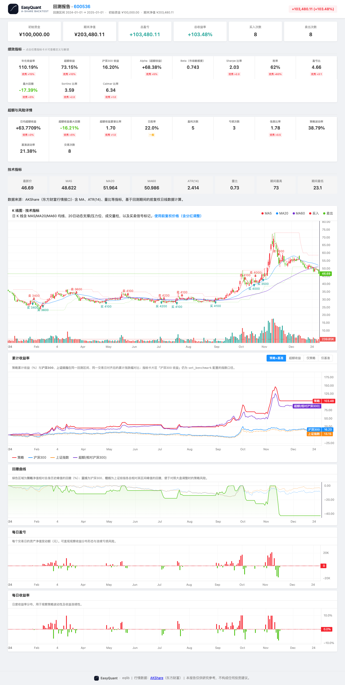
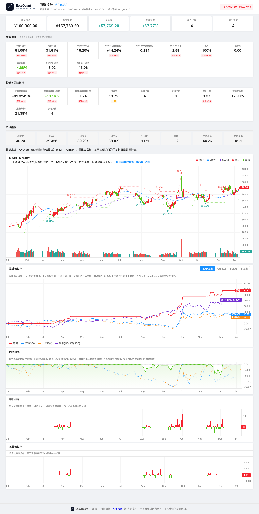
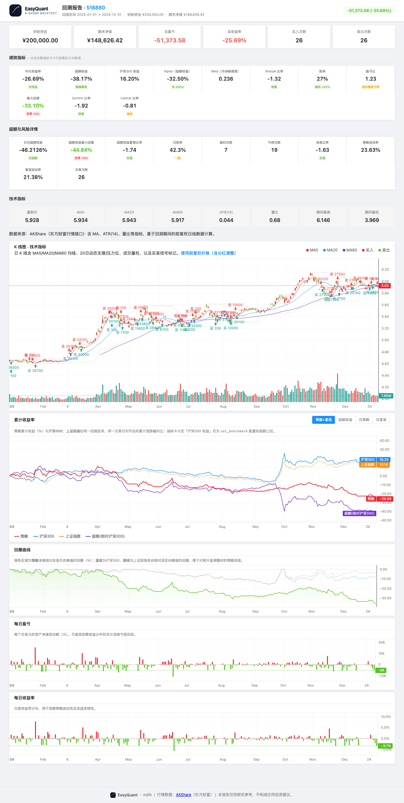

  

  <canvas aria-hidden="true"></canvas>
  演示数据 · Synthetic
  

  

    Event-Driven · China A-Share · Open Source
    <h1 class="eql-title eql-rise" style="animation-delay:.18s">让 A 股回测的 每一分钱，<em>都算数</em>。</h1>
    

      EasyQuant 是面向中国 A 股的事件驱动回测框架。<strong>交易所日历、涨跌停拦截、T+1、费用与滑点</strong>——
      把生产级的市场语义装进一行 <code>pip install</code>。
    

    

      <a class="eql-btn eql-btn--primary" href="tutorials/00-getting-started/">15 分钟上手 →</a>
      <a class="eql-btn eql-btn--ghost" href="https://github.com/AlanFokCo/EasyQuant">GitHub ★</a>
    

    

      $pip install easyquant-eqlib
      <button class="eql-install__copy" data-copied="已复制">复制</button>
    

  

  
Scroll

  

    <b>上证指数</b> 3,247.86 +0.87%
    <b>深证成指</b> 10,562.13 +1.24%
    <b>创业板指</b> 2,183.45 −0.62%
    <b>沪深300</b> 3,912.60 +0.45%
    <b>中证500</b> 5,834.02 −0.18%
    <b>科创50</b> 986.71 +2.03%
    北向资金净流入 +58.2亿
    涨/跌停62 / 7
    成交额<b>9,842亿</b>
    示例数据 · 仅演示
  

<section class="eql-section" markdown="off">
  

    

      

0+

单元测试 对抗性审查驱动

      

0个

实战示例 从入门到多策略组合

      

0个

数据接口 PIT 防护 会话内杜绝未来数据

      

0日

年化口径 贴合 A 股真实交易日

    

  

</section>

<section class="eql-section eql-section--alt" markdown="off">
  

    

      
Capabilities

      <h2 class="eql-sec-title">一个框架，覆盖从研究到实盘的完整链路</h2>
    

    

      

        
01

        
⚙

        <h3>事件驱动引擎</h3>
        
<code>initialize</code> → <code>run_daily</code> → <code>handle_data</code>，与 JoinQuant / Zipline 一致的编程模型。信号 T 日生成、T+1 开盘价成交，从机制上杜绝前视。

        <a class="eql-feat__link" href="explanation/backtest-model/">执行模型 →</a>
      

      

        
02

        
▤

        <h3>A 股全量数据</h3>
        
日线 / 分钟线 / Tick、财务摘要、资金流向、北向资金、涨跌停统计。本地缓存 + 断点续传，离线研究可复现。

        <a class="eql-feat__link" href="reference/api-data/">数据接口 →</a>
      

      

        
03

        
∑

        <h3>风险与归因</h3>
        
Sharpe / Sortino / Max Drawdown / Alpha·Beta，真 BHB 单期 Brinson 归因——配置 + 选择 + 交互，数学严格闭合。

        <a class="eql-feat__link" href="reference/api-analysis/">分析接口 →</a>
      

      

        
04

        
⛨

        <h3>组合风控</h3>
        
VaR、策略相关性、集中度风险、Kill Switch 熔断。

        <a class="eql-feat__link" href="how-to/portfolio-risk/">风控指南 →</a>
      

      

        
05

        
◉

        <h3>模拟盘 + 通知</h3>
        
实时数据模拟盘，交易时段门控，钉钉 / 飞书信号推送。

        <a class="eql-feat__link" href="how-to/paper-trade/">模拟盘 →</a>
      

      

        
06

        
⇄

        
<h3>PTrade · QMT 适配</h3>
        
策略一键导出券商实盘平台，研究到交易无缝衔接。

        <a class="eql-feat__link" href="how-to/export-ptrade/">导出指南 →</a>

      

    

  

</section>

<section class="eql-section" markdown="off">
  

    

      

        

          
Rigor

          <h2 class="eql-sec-title">四道防线， 让结果经得起复核</h2>
          
A 股市场的硬规则——交易所日历、涨跌停、T+1、费用——在 EasyQuant 里是默认行为，不是可选项。

        

        

          

            Ⅰ
            

              <h4>涨跌停默认拦截</h4>
              
<code>check_price_limit=True</code> 默认开启；幅度表含板块 × 日期维度（创业板 2020-08-24 起 20%）、ST 5% 通道；一字板不再"买得进、卖得掉"。

            

          

          

            Ⅱ
            

              <h4>PIT 数据契约</h4>
              
26 个取数接口在回测会话内截断到 T-1 或发出告警；<code>avoid_future_data</code> 严格模式直接报错。

            

          

          

            Ⅲ
            

              <h4>交易所权威日历</h4>
              
停牌日订单当日取消并记录原因；退市股超期无行情强制清算入账。回测区间不再被静默截断。

            

          

          

            Ⅳ
            

              <h4>含费用的真实口径</h4>
              
胜率 / 盈亏比计入双边佣金与印花税；基准缺失时 Alpha·Beta 渲染 <code>N/A</code> 而非静默数字。

            

          

        

      

      

        

          
strategy.py — eqlib

          
from eqlib import *

def initialize(context):
    g.security = '601390'          # 中国中铁
    set_benchmark('000300.XSHG')   # 沪深300
    run_daily(market_open, time='every_bar')

def market_open(context):
    hist = attribute_history(g.security, 20, '1d', ['close'])
    ma20 = hist['close'].mean()
    price = hist['close'].iloc[-1]
    if price > ma20 * 1.02:        # 突破 2% 全仓
        order_value(g.security, context.portfolio.available_cash)
    elif price < ma20 * 0.98:      # 跌破 2% 清仓
        order_target(g.security, 0)

result = run_strategy(initialize,
    start_date='2024-01-01', end_date='2024-12-31',
    starting_cash=100000, securities=['601390'])

# ✓ 成交受涨跌停/T+1/费用约束，无未来函数
# 示例输出（演示数据，非收益承诺）：
# 总收益 +21.88% · 夏普 0.33 · 最大回撤 −9.4%

        

      

    

  

</section>

<section class="eql-section eql-section--alt" markdown="off">
  

    

      
Reports

      <h2 class="eql-sec-title">每次回测，产出一份可交付的报告</h2>
      
权益曲线、回撤、月度收益、逐笔成交、归因明细——HTML / Markdown / JSON / PNG 四种格式，可直接进投研评审。

    

    

      <a class="eql-shot" href="assets/tutorials/example_report_html_macd_volume.png" target="_blank">
        
        MACD 趋势 + 成交量<small>策略信号与权益曲线</small>
      </a>
      <a class="eql-shot" href="assets/tutorials/example_report_html_bollinger.png" target="_blank">
        
        布林带均值回归<small>逐笔成交与回撤区间</small>
      </a>
      <a class="eql-shot" href="assets/tutorials/example_report_html_portfolio.png" target="_blank">
        
        组合策略 · 支撑/阻力<small>多股票组合评分与风险归因</small>
      </a>
    

    
不同策略回测结果因市场环境而异，以上仅为示例。

  

</section>

<section class="eql-cta eql-grain" markdown="off">
  

    <h2 class="eql-cta__title">从安装到第一份回测报告， 约 <em>15 分钟</em>。</h2>
    
从安装到产出第一份可信回测报告——教程、示例、API 参考全部就绪。

    

      <a class="eql-btn eql-btn--primary" href="tutorials/00-getting-started/">开始教程 →</a>
      <a class="eql-btn eql-btn--ghost" href="examples/">浏览 25 个示例</a>
    

  

</section>

  
本文档仅供学习研究，不构成投资建议 · For research only. Not investment advice.

