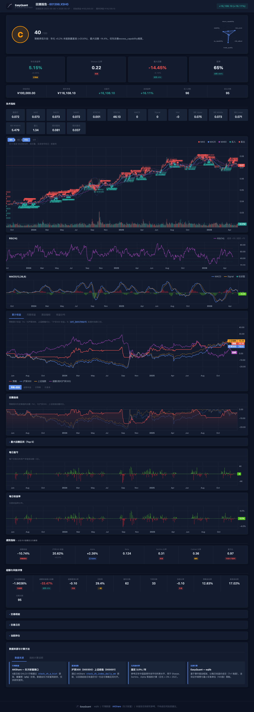
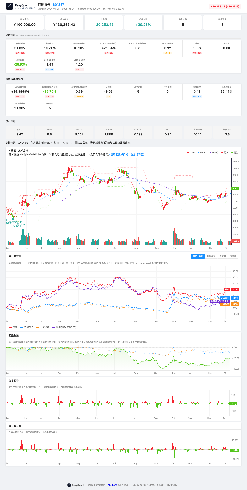
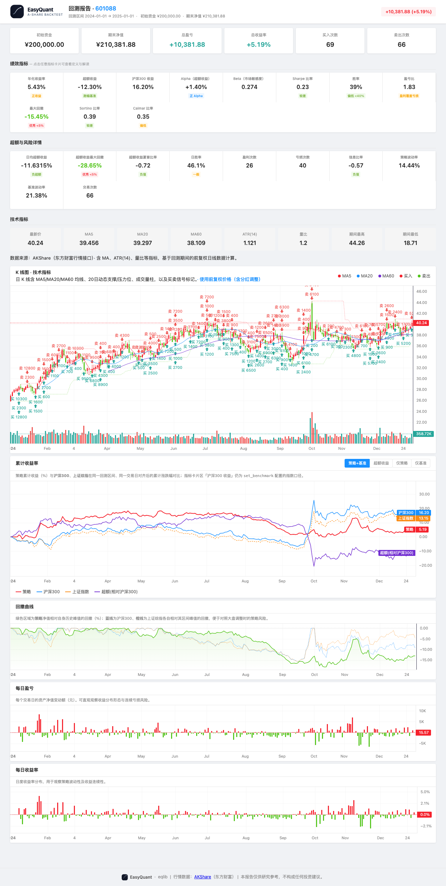
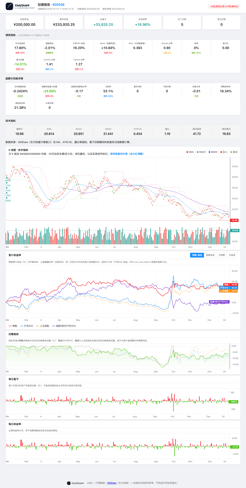

# Tutorial 02: 回测验证

!!! abstract "本篇导览"

    | 项目 | 说明 |
    |------|------|
    | **目标** | 读懂回测输出与风险指标，识别过拟合、未来函数与数据问题 |
    | **预计用时** | 60～90 分钟 |
    | **前置** | [Tutorial 00](00-getting-started.md)、[Tutorial 01](01-first-strategy.md)；详表见 [报告格式详解](../reference/reports-format.md) |

> 深入理解回测结果，解读报告和图表，判断策略是否真的有效。

**延伸阅读：** [FAQ](../project/faq.md)（HTML 空白、JSON 字段等排错）。

---

## 目录

1. [回测是什么](#1-回测是什么)
2. [回测能告诉你什么](#2-回测能告诉你什么)
   - [2.1 仓库内报告示例（reports/）](#21-仓库内报告示例reports)
   - [2.2 不同策略的回测报告对比](#22-不同策略的回测报告长什么样)
3. [解读回测报告](#3-解读回测报告)
4. [解读图表](#4-解读图表)
5. [风险与归因分析](#5-风险与归因分析)
6. [判断策略是否有效](#6-判断策略是否有效)
7. [常见回测陷阱](#7-常见回测陷阱)
8. [组合回测](#8-组合回测)
9. [下一步](#9-下一步)

---

## 1. 回测是什么

**回测（Backtesting）** 是把你的交易策略用历史数据"回放"一遍，看看如果当时真的按照这个策略交易，结果会怎样。

```
你的策略规则
     +
历史行情数据
     ↓
回测引擎 → 模拟交易 → 交易记录 + 组合价值曲线
```

### 回测的作用

- **验证想法**：你觉得有效的策略，真的能赚钱吗？
- **发现缺陷**：策略有没有你没想到的边界情况？
- **参数选择**：哪个参数组合更合理？
- **量化评估**：在投入真金白银之前，先用历史数据检验策略

### 回测不能告诉你什么

- **未来一定能赚钱**：历史表现不等于未来收益
- **精确的盈利金额**：回测有各种偏差（滑点、流动性等）
- **策略在所有市场环境都有效**：牛市有效的策略在熊市可能失效

---

## 2. 回测能告诉你什么

运行回测后，你会得到一组核心指标：

| 指标 | 含义 | 参考标准 |
|------|------|---------|
| **总收益率** | 回测期间的总盈利/亏损百分比 | 跑赢基准（沪深300）为好 |
| **年化收益率** | 折算为每年的收益率 | > 10% 为合格，> 20% 为优秀 |
| **年化波动率** | 收益的波动幅度 | 低一些更好（< 25% 为佳） |
| **夏普比率** | 每承受一单位风险，获得多少超额收益 | > 1 为好，> 2 为优秀 |
| **最大回撤** | 从最高点到最低点的最大亏损幅度 | 越小越好（< 15% 为佳） |
| **索提诺比率** | 类似夏普，但只考虑下行波动 | > 1 为好 |
| **Alpha** | 跑赢基准的超额收益 | 正数为好 |
| **Beta** | 相对大盘的敏感度 | 接近 1 = 跟随大盘 |
| **胜率** | 在 HTML 中可能对应「日胜率」或「交易胜率」，含义不同 | 见下文与 [报告格式详解](../reference/reports-format.md) |

> **说明：**`analyze_returns` 返回的 **`win_rate_daily`** 为按交易日统计的胜率；**`win_rate_trade`** 为完整买卖配对后的胜率（FIFO 配对，按扣除买卖双边费用后的净盈亏计胜负）。二者不可直接比较数值高低来判断策略好坏。

> **Alpha / Beta 可能显示 N/A**：二者依赖基准序列。基准数据缺失时 `alpha`、`beta`、`information_ratio` 为 `NaN`，报告中显示为 `N/A`——这不是计算错误，而是没有可对比的基准。

---

## 2.1 仓库内报告示例（`reports/`）

真实回测会在仓库根目录的 **`reports/`** 下写出四套文件（`.html` / `.png` / `.md` / `.json`）。文件名带时间戳；带后缀的（如 `_19_localdata`）通常对应示例脚本里的 `report_suffix` 或脚本说明。

**推荐阅读：** [解读回测报告](../how-to/read-reports.md) 讲解了四种报告的读法。下面的截图来自示例 [`06_local_data.py`](https://github.com/AlanFokCo/EasyQuant/blob/main/examples/06_local_data.py) 的一次真实运行；仓库只保存 PNG 截图（`docs/assets/tutorials/`），交互式 `.html` 需要你本地运行示例脚本生成。



**想自己打开交互式版本：** 在仓库根执行 `python examples/06_local_data.py`，然后在 `reports/` 中用浏览器打开最新生成的 `.html`（**累计收益与回撤图**中含沪深300与上证综指双线基准）。

抽象「策略 vs 基准」折线示意见仍保留：`../assets/tutorials/sample_equity_vs_benchmark.svg`。

**对照 HTML 页眉与指标卡片读数：**打开本地生成的 `.html` 后，按 [报告格式详解](../reference/reports-format.md) 的指标说明逐条对照；若图区空白，多为 CDN 被拦，见 [FAQ](../project/faq.md)。

---

## 2.2 不同策略的回测报告长什么样？

同一个框架，不同策略的报告 **结构相同、数值不同**。下面 6 张截图来自已跑通的示例：页面结构相同，指标卡片数值截然不同。交互式 `.html` 不随仓库分发，在本地运行对应示例脚本即可生成。

> 注意：以下数字为特定回测区间和标的下的结果，**仅供展示报告格式**，实际收益会因市场环境、回测区间、标的选择而大幅变化，不构成任何投资建议。

### 布林带均值回归（Example 15，股票 601088 中国神华）


> 布林带策略在震荡市表现优异——价格触及下轨买入、上轨卖出，天然的低买高卖逻辑。实际回测结果因市场环境而异。

### MACD 趋势 + 成交量确认（Example 16，股票 002594 比亚迪）


> 科技股波动大，MACD 金叉配合放量确认，能较好地捕捉趋势启动点。实际回测结果因市场环境而异。

### 网格交易（Example 18，股票 601398 工商银行）



> 网格适合低波动、有明确价格区间的股票——在区间内反复"低吸高抛"。实际回测结果因市场环境而异。

### 多因子选股（Example 17，7 只股票池）



> 多因子模型每周从 7 只股票中选出动量/成交量/波动率综合得分最高的 3 只，高频换手。实际回测结果因市场环境而异。

### 单标的策略报告页（标的 002384）



> 同一份报告模板用于单标的中低频策略：K 线 + 买卖点、累计收益、回撤、每日盈亏、成交明细。实际回测结果因市场环境而异。

### 组合回测（Example 11，5 只候选选前 3）


> 组合示例在 5 只候选股中按 20 日动量选前 3 只持仓。动量策略在某些市场环境中可能"追涨杀跌"导致亏损，在另一些环境中可能表现较好。实际回测结果因市场环境而异。

**阅读建议：** 任选上述示例脚本在本地运行（如 `python examples/15_bollinger_strategy.py`），用浏览器打开生成的 `.html`，观察相同页面结构下，不同策略的指标卡片、K 线、回撤曲线、成交表的差异。

---

## 3. 解读回测报告

### 3.1 运行回测生成报告

```python
from eqlib import *

def initialize(context):
    g.security = '601398'
    set_benchmark('000300.XSHG')
    set_order_cost(OrderCost(
        open_tax=0, close_tax=0.0005,
        open_commission=0.00025, close_commission=0.00025,
        min_commission=5,
    ))
    run_daily(market_open, time='every_bar')

def market_open(context):
    hist = attribute_history(g.security, 25, '1d', ['close'])
    if hist.empty or len(hist) < 20:
        return
    ma5 = hist['close'].tail(5).mean()
    ma20 = hist['close'].tail(20).mean()
    price = hist['close'].iloc[-1]

    if price > ma5 > ma20:
        if g.security not in context.portfolio.positions:
            order_value(g.security, context.portfolio.available_cash * 0.95)  # 留 5% 费用缓冲
            log.info('BUY %s @ %.3f' % (g.security, price))
    elif price < ma5 < ma20:
        if g.security in context.portfolio.positions:
            order_target(g.security, 0)
            log.info('SELL %s @ %.3f' % (g.security, price))

    record(price=price, ma5=ma5, ma20=ma20)

result = run_strategy(
    initialize,
    start_date='2024-01-01',
    end_date='2024-12-31',
    starting_cash=100000,
    benchmark='000300.XSHG',
    securities=['601398'],
)
```

> **成本口径**：以上为现行费率（印花税 2023-08-28 起 0.05%，此前 0.1%）。显式固定 `close_tax` 会覆盖引擎内建的日期感知逻辑；跨 2023-08-28 的长历史回测请改用 `close_tax=None`。滑点见 [配置 API](../reference/api-config.md)（示例默认 `FixedSlippage(0.001)`）。

### 3.2 交互式 HTML 报告

用浏览器打开 `reports/backtest_*.html`（无需本地 Web 服务器）。自上而下通常为：**摘要** → **指标卡片**（年化收益、夏普、最大回撤、Alpha/Beta 等，可点击看释义）→ **K 线与技术指标** → **累计收益率**（策略 vs 基准）→ **回撤** → **每日盈亏 / 每日收益率** → **成交、持仓**等标签页。

各字段与 `analyze_returns` 字典键的对应关系见 [**报告格式详解**](../reference/reports-format.md)；各区块的读法见 [解读回测报告](../how-to/read-reports.md)。

### 3.3 Markdown 报告

文件路径：`reports/backtest_YYYYMMDD_HHMMSS.md`

报告由 `generate_report_md` 生成，标题为 `# Backtest Report — 601398`（破折号后接首个成交标的）。各区块按以下顺序出现：

| 区块 | 内容 |
|------|------|
| `## Strategy Summary` | 区间、初始资金、期末资产、P&L、基准及基准收益（表格） |
| `## Grade Breakdown` | 各维度得分、评级与关键指标，末尾 Overall 行 |
| `## Performance Metrics` | 年化收益、波动率、夏普、索提诺、最大回撤、卡玛、Alpha、Beta、信息比率、交易胜率、盈亏比、交易次数（含基准对照列） |
| `## Monthly Returns` | 年 × 月收益矩阵 + YTD |
| `## Rolling Metrics` | 60 日滚动夏普/波动率（按季度抽样） |
| `## Top 5 Drawdown Periods` | 前五回撤区间：起点、谷底、修复、深度、持续天数 |
| `## Trade Analysis` | 买/卖单数、总佣金、成交标的数；多标的时附 `### Per-Stock P&L` |
| `## Trade P&L` | FIFO 配对表：`\| # \| Security \| Buy Date \| Buy Price \| Sell Date \| Sell Price \| P&L \|` |
| `## Factor Analysis` / `## Brinson Attribution` | 因子暴露与 Brinson 归因（数据可得时才有） |
| `## Data Sources` | 数据来源、无风险利率口径与免责声明 |

**重点关注：**

1. **P&L 与基准**（Strategy Summary）：
   - 同时看绝对收益和相对收益
   - 与 Benchmark Return 对比：策略涨 8% 而同期沪深 300 涨 15%，就是跑输基准

2. **交易频率**（Trade Analysis）：
   - 交易次数过多 = 换手率高 = 手续费吃利润
   - 交易次数过少 = 可能信号不够灵敏

3. **每笔配对盈亏**（Trade P&L）：
   - 逐笔检查买入价和卖出价，P&L 已扣除双边费用
   - 如果大部分交易都亏损，说明信号质量不好

4. **佣金成本**（Trade Analysis）：
   - 对比 Total commission 与 P&L 的量级
   - 小额交易的佣金占比会很高（最低 5 元限制）

### 3.4 JSON 报告

文件路径：`reports/backtest_YYYYMMDD_HHMMSS.json`

由 `generate_report_json` 生成，顶层键：

| 键 | 内容 |
|------|------|
| `verdict` | `pass` / `grade` / `score` / `bottleneck` / `action`（`complete` 或 `adjust_params`）/ `summary` |
| `targets` | 逐项指标达标检查：`metric`、`value`、`target`、`pass`（未达标按 `priority` 排序；基准缺失的指标 `pass` 为 `null`） |
| `diagnostics` | 瓶颈诊断列表 |
| `recommendations` | 参数调整建议 |
| `grade` | 评级明细（各维度得分） |
| `metrics` | `analyze_returns` 的全部标量指标（`NaN`/`inf` 序列化为 `null`） |
| `time_series` | `monthly_returns`、`rolling_sharpe_60d`、`rolling_volatility_60d`、`drawdown_periods` |
| `summary` | `start_date`、`end_date`、`initial_capital`、`final_value`、`pnl`、`pnl_pct`、`num_trades`、`securities`、`benchmark`、`benchmark_return` |
| `risk_metrics` | 兼容旧版的指标子集 |
| `cumulative_returns` | 每日 `{date, total_value, cumulative_return}` |
| `trades` | 逐笔成交：`type`、`date`、`security`、`price`、`amount`、`commission` |
| `positions` | 期末持仓：`amount`、`avg_cost`、`total_value` |
| `chart_data` | K 线、成交量、累计收益、回撤等绘图数据 |
| `factor_analysis` / `brinson_attribution` | 归因结果（数据可得时才有） |

```python
import json

with open('reports/backtest_20260503_143000.json') as f:
    report = json.load(f)

# 基本指标
print("总收益: %.2f%%" % report['summary']['pnl_pct'])
print("交易次数:", report['summary']['num_trades'])
print("夏普比率: %.2f" % report['metrics']['sharpe_ratio'])

# 每日组合价值曲线
for entry in report['cumulative_returns']:
    print(entry['date'], entry['total_value'], entry['cumulative_return'])

# 达标检查：哪些指标没过
for t in report['targets']:
    if t['pass'] is False:
        print("未达标:", t['metric'], t['gap'])
```

JSON 报告适合做进一步的数据分析，比如：
- 计算最大连续亏损天数
- 分析持仓/空仓天数比例
- 画出累计收益曲线

### 3.5 HTML 交互式报告怎么读

HTML 报告是最常用的回测分析工具。用浏览器打开后，自上而下的区块与读法：

| 区块 | 内容 | 读法 |
|------|------|------|
| **页头摘要** | 标的、区间、初始/最终资金与盈亏 | 盈亏是否为正、占初始资金比例多少 |
| **核心指标卡片** | 年化收益、超额收益、夏普、最大回撤、胜率（交易）、卡玛比率 | 别只看收益——夏普和回撤说明「赚这个钱承担了多少风险」。参考值：夏普 > 1、回撤 < 20%、卡玛 > 1 |
| **详细指标行** | 年化波动率、索提诺、Alpha、Beta、信息比率、日胜率、盈亏比 | Alpha 为正 + Beta 接近 1：超额收益不是赌方向赌来的。Alpha/Beta 依赖基准，基准缺失时显示 N/A |
| **K 线与技术指标** | 价格线 + MA5/MA20 + 买卖点标记 + 成交量，绿色阴影为持仓期 | 买点是否在低位、持仓期价格是否上涨、交易是否过密 |
| **累计收益率** | 策略曲线 vs 基准曲线（沪深300 + 上证综指双线） | 策略线持续在基准上方 = 稳定跑赢；两线平行 = 没有 alpha |
| **回撤曲线** | 从历史新高的回落深度 | 看最深处：那段时间你能否接受 |
| **每日盈亏/收益率** | 每个交易日的盈亏柱状图 | 有无连续亏损、单日亏损是否过大、收益是否集中在少数几天 |
| **标签页** | 成交明细、期末持仓、Brinson 归因 | 逐笔检查成交；归因看收益来自配置还是选股 |

**阅读顺序：** 页头（赚钱了吗）→ 指标卡片（夏普 > 1？回撤 < 20%？）→ 累计收益图（跑赢基准了吗）→ 回撤曲线（最差情况能接受吗）→ 成交表（每笔交易合理吗）→ 归因（收益来自配置还是选股）。

---

## 4. 解读图表

### 4.1 图表结构

```
  |                                                     |  Portfolio Value
P |  ---MA5                                              |
r |  ---MA20                                             |
i |  ---Close                                            |
c |                                                      |
e |     [SELL]    [BUY]                                  |
  |    o          o     o[SELL]                          |
  |   / \  ===== / \___/   \                             |
  |  /   \      /           \                            |
  | /     \====/             \=====                      |
  +------------------------------------------------------|-> Date
```

### 4.2 图表元素

| 元素 | 含义 |
|------|------|
| **灰色线** | 股票每日收盘价 |
| **蓝色线** | 5 日均线（短期趋势） |
| **橙色线** | 20 日均线（中期趋势） |
| **绿色圆圈** | 买入点（价格下方标注） |
| **红色圆圈** | 卖出点（价格上方标注） |
| **绿色阴影** | 持仓期间 |
| **绿色线（右侧轴）** | 投资组合总资产价值 |

### 4.3 如何看图

**好的信号：**
- BUY 点通常在价格低位（均线金叉附近）
- SELL 点通常在价格高位（均线死叉附近）
- 资产曲线（右轴）整体向上
- 持仓期间（绿色阴影）价格有明显上涨

**不好的信号：**
- BUY 和 SELL 频繁交替 → 震荡市中反复被"打脸"
- 资产曲线持续向下 → 策略亏损
- 持仓期间价格无明显变化 → 无效信号

---

## 5. 风险与归因分析

### 5.1 综合风险指标

```python
from eqlib import analyze_returns

metrics = analyze_returns(result, risk_free_rate=0.03)

print("年化收益:   %.2f%%" % (metrics['annual_return'] * 100))
print("年化波动:   %.2f%%" % (metrics['annual_volatility'] * 100))
print("夏普比率:   %.2f" % metrics['sharpe_ratio'])
print("索提诺比率: %.2f" % metrics['sortino_ratio'])
print("最大回撤:   %.2f%%" % (metrics['max_drawdown'] * 100))
print("卡玛比率:   %.2f" % metrics['calmar_ratio'])
print("Alpha:      %.4f" % metrics['alpha'])
print("Beta:       %.3f" % metrics['beta'])
print("日胜率:     %.2f%%" % (metrics['win_rate'] * 100))
```

> 说明：`win_rate` 是 `win_rate_daily`（日胜率）的兼容别名；配对交易胜率用 `metrics['win_rate_trade']`，它按扣除买卖双边费用后的净盈亏判胜负。基准数据缺失时 `alpha` / `beta` / `information_ratio` 为 `NaN`，直接 `%` 格式化会打出 `nan`——展示前先判 `math.isfinite`，或按报告惯例显示 `N/A`。

### 5.2 Brinson 归因（多股票组合）

将收益拆解为三个来源：

```python
from eqlib import brinson_attribution

attr = brinson_attribution(result, sector_data={"601398.XSHG": "金融", "600519.XSHG": "消费"})

print("配置效应: %.4f  ← 资产配置（选行业/板块）带来的收益" % attr['allocation_effect'])
print("选股效应:   %.4f  ← 个股选择带来的收益" % attr['selection_effect'])
print("交互效应:   %.4f  ← 配置与选股的交互作用" % attr['interaction_effect'])
```

实现为标准 Brinson-Hood-Beebower 单期分解：三项之和**严格等于**组合收益 − 基准收益（`attr['total_active_return']`，另见 `portfolio_return` / `benchmark_return` / 分行业明细 `attr['sectors']`）。基准默认为 universe 等权买入持有收益。注意：**不传 `sector_data` 时所有证券同属一个行业**，配置与交互效应恒为 0，全部超额收益计入选股效应——这不是缺陷，而是无行业结构时 BHB 的正确表述。

- **配置效应 > 0**：说明你的板块/行业选择是对的
- **选股效应 > 0**：说明你在板块内选的股票是对的
- **交互效应**：通常是小的调整项

### 5.3 简化因子分析

```python
from eqlib import simple_factor_analysis

ff = simple_factor_analysis(result)

print("市场 Beta:    %.3f  ← 大盘敏感度" % ff['market_beta'])
print("年化 Alpha:   %.4f  ← 市场无法解释的超额收益" % ff['alpha_annual'])
print("动量相关性:   %.3f" % ff['momentum_correlation'])
print("残差波动率:   %.3f" % ff['residual_volatility'])
```

> **注意：** `fama_french_analysis` 已弃用，请改用 `simple_factor_analysis`。

---

## 6. 判断策略是否有效

### 6.1 核心判断标准

| 问题 | 判断标准 |
|------|---------|
| **策略赚钱了吗？** | 总收益率 > 0 |
| **跑赢大盘了吗？** | 策略收益 > 基准收益（沪深300） |
| **风险调整后的表现好吗？** | 夏普比率 > 1 |
| **最大回撤能接受吗？** | 最大回撤 < 你的心理承受范围 |
| **交易频率合理吗？** | 不是一天一换，也不是半年一换 |

### 6.2 综合评估模板

```python
metrics = analyze_returns(result, risk_free_rate=0.03)

checks = []
checks.append(("收益 > 0", metrics['total_return'] > 0))
checks.append(("跑赢基准", metrics['alpha'] > 0))  # 无基准时 alpha 为 NaN，该项自动 FAIL
checks.append(("夏普 > 1", metrics['sharpe_ratio'] > 1))
checks.append(("回撤 < 20%", abs(metrics['max_drawdown']) < 0.20))
checks.append(("交易胜率 > 50%", metrics['win_rate_trade'] > 0.50))

print("--- 策略评估 ---")
passed = 0
for name, ok in checks:
    status = "PASS" if ok else "FAIL"
    if ok:
        passed += 1
    print("  [%s] %s" % (status, name))
print("通过 %d/%d 项检查" % (passed, len(checks)))
```

### 6.3 样本外验证

```python
# 训练集：2020-2023，用来调整参数
result_train = run_strategy(
    initialize, '2020-01-01', '2023-12-31',
    starting_cash=100000, securities=['601398'],
)

# 测试集：2024，用来验证
result_test = run_strategy(
    initialize, '2024-01-01', '2024-12-31',
    starting_cash=100000, securities=['601398'],
)

# 如果训练集夏普 2.0，测试集夏普 0.3 → 过拟合
# 如果训练集夏普 1.5，测试集夏普 1.2 → 参数稳定
```

---

## 7. 常见回测陷阱

### 7.1 过拟合

```
回测年化 50%，实盘年化 5%
原因：参数在历史数据上反复调试，恰好"记住"了历史走势
```

**识别方法**：参数微调后结果剧烈变化 → 过拟合

### 7.2 未来函数

```python
# 错误示例：使用当天收盘价做开盘决策
# attribute_history 返回的是昨天的数据，这个是正确的
# 但如果策略中用了 get_today_close() 或其他包含当天数据的方式，就是未来函数
```

### 7.3 幸存者偏差

```
只测了当前还在上市的股票 → 忽略了退市/ST 的股票
→ 回测结果虚高
```

### 7.4 忽略流动性

```
回测用 100 万买入某股，但该股日均成交仅 50 万
→ 实际无法成交，回测结果无效
```

### 7.5 回测期间太短

```
只回测了 3 个月 → 可能刚好遇到牛市/熊市
→ 建议至少回测 1-2 年，涵盖不同市场环境
```

### 7.6 不了解引擎的默认行为

以下默认行为直接影响成交结果，读报告前先知道它们存在：

| 行为 | 默认 | 说明 |
|------|------|------|
| 涨跌停拦截 | 开（`check_price_limit=True`） | 涨停开盘的买单、跌停开盘的卖单被取消并记 `cancel_reason`；`set_option('check_price_limit', False)` 关闭 |
| 停牌处理 | 当日订单取消 | 无行情或零成交视为停牌，当日不下发订单 |
| 退市清算 | 30 个无行情交易日后强制平仓 | 交易记录类型为 `DELIST_LIQUIDATE`；`set_option('delist_gap_days', N)` 调整 |
| 快照类数据接口 | 回测内调用发 `FutureWarning` | `get_fundamentals` 等返回当前快照；`set_option('avoid_future_data', True)` 升级为报错 |

---

## 8. 组合回测

### 8.1 单股 vs 组合

| | 单股回测 | 组合回测 |
|--|---------|---------|
| 适用场景 | 验证单个策略逻辑 | 多股轮动、资产配置 |
| API | `run_strategy` / `run_backtest` | `run_portfolio_backtest` |
| 股票池 | 一只股票 | 多只股票 |
| 仓位控制 | `context.portfolio.available_cash` | `position_pct` 或 `position_amount` |

### 8.2 组合回测示例

```python
from eqlib import StrategyConfig, run_portfolio_backtest

# 定义配置
config = StrategyConfig(
    starting_cash=200000,
    securities=['601398', '600519', '000858'],
    benchmark='000300.XSHG',
    position_pct=0.33,       # 每只股票最多用 33% 可用资金
    start_date='2024-01-01',
    end_date='2024-12-31',
    report_suffix='multi_stock_v1',
)

# 策略函数
def my_strategy(context):
    for sec in context.universe:
        hist = attribute_history(sec, 25, '1d', ['close'])
        if hist.empty:
            continue
        ma20 = hist['close'].tail(20).mean()
        price = hist['close'].iloc[-1]

        if price > ma20 * 1.02:
            order_value(sec, context.portfolio.available_cash * 0.33)
        elif price < ma20 * 0.98 and context.portfolio.positions.get(sec):
            order_target(sec, 0)

# 运行回测
result = run_portfolio_backtest(config, my_strategy)
```

### 8.3 组合回测输出

下面是**示意输出**（数字仅为格式示例，以实际运行为准）：

```
==================================================
Portfolio Backtest: 2024-01-01 → 2024-12-31
Universe: ['601398', '600519', '000858']
Rebalance: daily
==================================================
Starting Cash:         200,000.00
Final Value:           215,342.00
P&L:                 +15,342.00 (+7.67%)
Total Trades:              12

--- Per-Stock Summary ---
  600519: 3 buys, 3 sells, net shares 0, realized ¥5,200.00
  601398: 4 buys, 4 sells, net shares 0, realized ¥3,100.00
  000858: 5 buys, 5 sells, net shares 0, realized ¥7,042.00
```

---

## 9. 下一步

学会了解读回测结果后，接下来：

- **[Tutorial 03: 策略优化与改进](03-optimization.md)** — 参数调优、组合优化、归因分析、避免过拟合
- **[Tutorial 05: RSI 均值回归策略](05-rsi-mean-reversion.md)** — 换一种策略思路，学习均值回归
- **[Example 19: 支撑阻力位组合策略](https://github.com/AlanFokCo/EasyQuant/blob/main/examples/19_sr_portfolio/README.md)** — 一个完整的多股票组合策略实战案例，包含预生成的回测报告，可直接查看策略表现
- **[Tutorial 04: 模拟盘到实盘](04-live-trading.md)** — 从模拟盘到 PTrade/QMT 实盘部署
